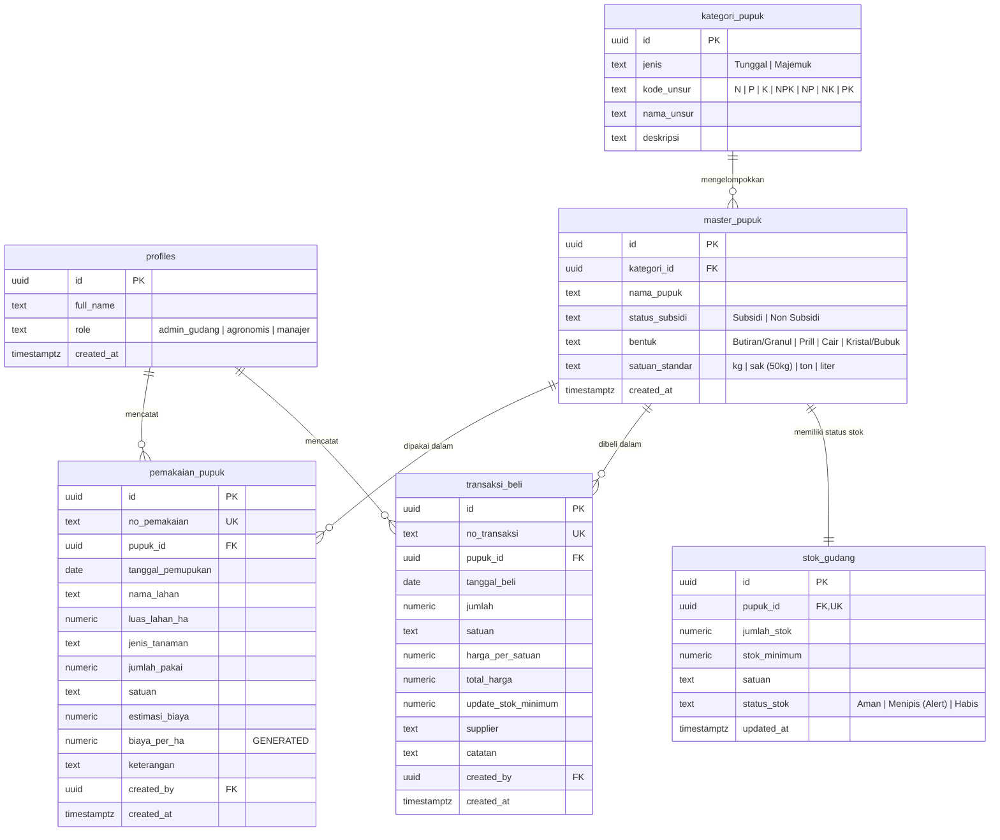

<p align="center">
  
  
  
  
  <br/>
  
  
  
  
  <br/>
  
  
</p>
# 🌾 SIM Pupuk: Sistem Informasi Manajemen Inventaris & Pemakaian Pupuk
**Final Project Kelompok 3 — Mata Kuliah Sistem Informasi Manajemen (SIM)**  
*Pendekatan Pengembangan: Vibe Coding dengan AI Coding Tools & Relational Cloud Backend*

---

## 📌 Daftar Isi
1. [Tentang Proyek](#-tentang-proyek)
2. [Tujuan & Luaran Final Project](#-tujuan--luaran-final-project)
3. [Pembagian Peran & Alur Kolaborasi](#-pembagian-peran--alur-kolaborasi)
4. [Kebutuhan Fungsional & Spesifikasi Sistem](#-kebutuhan-fungsional--spesifikasi-sistem)
5. [Arsitektur Basis Data (PostgreSQL / Supabase)](#-arsitektur-basis-data-postgresql--supabase)
6. [Aturan Bisnis & Otomasi Database (Triggers & Functions)](#-aturan-bisnis--otomasi-database-triggers--functions)
7. [Hak Akses Pengguna (Role-Based Access Control & RLS)](#-hak-akses-pengguna-role-based-access-control--rls)
8. [Panduan Integrasi Desain UI/UX Figma ke Frontend](#-panduan-integrasi-desain-uiux-figma-ke-frontend)
9. [Panduan Setup Repositori GitHub & Kerja Tim](#-panduan-setup-repositori-github--kerja-tim)
10. [Rencana Pengujian (Testing & Validation)](#-rencana-pengujian-testing--validation)

---

## 📖 Tentang Proyek

**SIM Pupuk** adalah aplikasi berbasis web yang dirancang untuk mengelola rantai pasok dan pemanfaatan pupuk pertanian secara terintegrasi—mulai dari penerimaan pupuk di gudang, pengawasan ambang batas stok minimum, pencatatan pemakaian di tiap blok lahan pertanian, hingga analisis rasio efisiensi biaya pemupukan per hektar.

Sistem ini menyelesaikan permasalahan nyata dalam manajemen pupuk:
- Kesulitan melacak pupuk subsidi vs non-subsidi.
- Kompleksitas klasifikasi pupuk berdasarkan kandungan hara makro (Tunggal: N, P, K vs Majemuk: NPK, NP, NK, PK).
- Keterlambatan pasokan akibat tidak adanya notifikasi dini stok minimum.
- Sulitnya mengukur biaya riil pemupukan per satuan luas lahan.

---

## 🎯 Tujuan & Luaran Final Project

Berdasarkan silabus `Tugas Kelompok 3 SIM - FInal Project (1).pdf`, luaran wajib proyek ini meliputi:
1. **Source Code**: Repositori GitHub terstruktur dengan riwayat commit rapi.
2. **Database**: Skema basis data relasional PostgreSQL aktif di cloud (Supabase) dengan tabel, relasi, trigger, dan constraint validasi.
3. **Fitur Lengkap Sesuai Proposal (`Pupuk.docx`)**:
   - Cascading dropdown pemilihan pupuk + live search filter.
   - Dashboard analitik & KPI stok.
   - Manajemen stok gudang & sistem notifikasi stok menipis.
   - Modul transaksi pembelian (restock) dengan auto-calculation.
   - Modul pencatatan pemakaian pupuk per lahan & tanaman.
   - Riwayat data dengan kemampuan edit & audit.
   - Analitik rasio biaya vs luas lahan ($/Ha atau Rp/Ha).
   - Ekspor laporan ke format Excel (.xlsx) dan PDF siap cetak.
4. **Hak Akses Pengguna**: Manajemen peran (Admin Gudang, Agronomis/Operator Lahan, Manajer).
5. **Validasi & Pengujian**: Pencegahan input minus, pencegahan stok minus (*stock deficit prevention*), dan validasi integritas data.
6. **Dokumentasi Laporan PDF & Demo Video YouTube**: Laporan akhir format PDF serta tautan video presentasi demonstrasi aplikasi.

---
## ⚙️ Kebutuhan Fungsional & Spesifikasi Sistem

Mengacu pada dokumen kebutuhan teknis `Pupuk.docx`:

### 1. Hierarki Pemilihan Pupuk (Cascading Dynamic Dropdown)
Sistem menyediakan pemilihan bertingkat yang intuitif dengan fitur **live search** dan **filter**:
- **Tingkat 1 - Kategori/Kandungan**:
  - *Pupuk Tunggal*: Mengandung satu jenis unsur hara makro utama (Nitrogen, Fosfor, atau Kalium).
  - *Pupuk Majemuk*: Mengandung lebih dari satu unsur hara (NPK, NP, NK, PK).
- **Tingkat 2 - Status Subsidi**:
  - *Subsidi* (contoh: "Urea – Subsidi", "NPK Phonska – Subsidi").
  - *Non Subsidi* (contoh: "Urea", "NPK Mutiara 16-16-16").
- **Tingkat 3 - Kelompok Unsur Hara**:
  - Jika Tunggal: `Nitrogen` (N), `Fosfor` (P), `Kalium` (K).
  - Jika Majemuk: `NPK`, `NP`, `NK`, `PK`.
- **Tingkat 4 - Item Pupuk**:
  - Daftar pupuk spesifik berdasarkan kelompok unsur dan status subsidi yang dipilih.
  - Didukung fitur pencarian instan (*autocomplete*) tanpa harus mengklik bertingkat jika nama produk sudah diketahui.

---

## 🗄️ Arsitektur Basis Data (PostgreSQL / Supabase)

Arsitektur database mengadopsi standar **Supabase Postgres Best Practices**: menggunakan penamaan *snake_case*, kunci utama UUID v4 (`gen_random_uuid()`), relasi integritas referensial dengan indeks pada *foreign key*, tipe data presisi `numeric` untuk keuangan/kuantitas, dan *generated columns* untuk efisiensi kueri.

### Diagram Relasi Entitas (ERD)



---

## ⚡ Aturan Bisnis & Otomasi Database (Triggers & Functions)

Seluruh integritas data dijaga di level basis data menggunakan PL/pgSQL Triggers:

1. **Sinkronisasi Stok Masuk (`trg_transaksi_beli_stok`)**:
   - Setiap transaksi pembelian baru secara otomatis menambah `jumlah_stok` pada tabel `stok_gudang`.
   - Jika kolom `update_stok_minimum` diisi, nilai ambang batas pada `stok_gudang` otomatis diperbarui.
   - Jika transaksi pembelian diubah (*update*) atau dihapus (*delete*), stok gudang akan dikoreksi secara akurat.

2. **Validasi & Pengurangan Stok Keluar (`trg_pemakaian_pupuk_stok`)**:
   - Sebelum data pemakaian disimpan (`BEFORE INSERT`), trigger memeriksa apakah stok tersedia di gudang mencukupi (`jumlah_pakai <= jumlah_stok`).
   - Jika stok tidak mencukupi, sistem membatalkan transaksi dan mengirim pesan error:  
     `"Stok pupuk di gudang tidak mencukupi untuk pemakaian ini!"`
   - Jika valid, `jumlah_stok` otomatis dipotong sejumlah pemakaian.

3. **Kalkulasi Otomatis Biaya Pemupukan**:
   - Nilai `estimasi_biaya` dihitung berdasarkan harga perolehan rata-rata pupuk.
   - Kolom `biaya_per_ha` dihitung otomatis melalui *Generated Column*:
     $$\text{biaya\_per\_ha} = \frac{\text{estimasi\_biaya}}{\text{luas\_lahan\_ha}}$$

4. **Deteksi Otomatis Stok Minimum (Alert Trigger)**:
   - Kolom `status_stok` pada `stok_gudang` berstatus `'Menipis (Alert)'` saat:
     $$\text{jumlah\_stok} \le \text{stok\_minimum}$$
   - Status ini mentrigger alert pop-up dan banner peringatan di aplikasi web.

---

## 🔐 Hak Akses Pengguna (Role-Based Access Control & RLS)

Sistem menggunakan Supabase Row-Level Security (RLS) dengan 3 peran pengguna:

| Modul / Tindakan | Admin Gudang | Agronomis / Petugas Lapangan | Manajer / Pimpinan |
| :--- | :---: | :---: | :---: |
| **Melihat Dashboard & KPI** | ✅ Ya | ✅ Ya | ✅ Ya |
| **Melihat Stok Gudang** | ✅ Ya | ✅ Ya | ✅ Ya |
| **Input Pembelian Pupuk** | ✅ Ya | ❌ Tidak | ❌ Tidak |
| **Edit/Hapus Riwayat Beli** | ✅ Ya | ❌ Tidak | ❌ Tidak |
| **Input Pemakaian di Lahan** | ✅ Ya | ✅ Ya | ❌ Tidak |
| **Edit Riwayat Pemakaian** | ✅ Ya | ✅ Ya | ❌ Tidak |
| **Atur Stok Minimum** | ✅ Ya | ❌ Tidak | ❌ Tidak |
| **Lihat Analisis Rasio Biaya/Luas** | ✅ Ya | ✅ Ya | ✅ Ya (Prioritas) |
| **Unduh Laporan XLSX / PDF** | ✅ Ya | ✅ Ya | ✅ Ya |

---

## 🎨 Panduan Integrasi Desain UI/UX Figma ke Frontend

Bagi rekan tim yang menyusun desain di **Figma**, berikut panduan struktur antarmuka dan komponen yang perlu disiapkan agar mudah diimplementasikan ke kode:

1. **Palet Warna Disarankan**:
   - *Primary*: Forest Green (`#15803d` / Emerald `#059669`) — melambangkan agrikultur dan kesuburan tanaman.
   - *Secondary / Accent*: Amber / Sun Yellow (`#f59e0b`) — untuk status subsidi & warning stok menipis.
   - *Danger / Alert*: Rose Red (`#e11d48`) — untuk peringatan stok habis atau batas minimum terlampaui.
   - *Background & Neutral*: Slate Clean White (`#f8fafc` & `#0f172a`).

2. **Daftar Halaman / Screen yang Diperlukan di Figma**:
   - `01_Login_&_Role_Selection`: Tampilan login dengan pilihan peran (*Admin Gudang*, *Agronomis*, *Manajer*).
   - `02_Dashboard`: Tampilan kartu statistik, grafik pemakaian, dan alert banner stok kritis.
   - `03_Stok_Gudang`: Tabel inventaris dengan badge status warna (*Aman*, *Menipis*, *Habis*).
   - `04_Beli_Pupuk`: Form input dengan **Cascading Dropdown** (Tunggal/Majemuk -> Subsidi/Non -> Unsur -> Pupuk), kalkulasi otomatis subtotal, dan opsi stok minimum.
   - `05_Pemakaian_Lahan`: Form input pemilihan pupuk dari stok yang ada, nama lahan, luas (ha), jenis tanaman, dan textarea catatan kondisi cuaca.
   - `06_Riwayat_Transaksi`: Tabel riwayat beli dan pakai dengan tombol aksi Edit & Detail.
   - `07_Statistik_&_Laporan`: Halaman grafik perbandingan lahan, rasio biaya/luas, serta tombol ekspor Excel/PDF.

3. **Catatan Form Dropdown (Penting)**:
   - Sediakan komponen visual untuk **Searchable Dropdown / Select dengan Live Filter** agar pengguna dapat mencari pupuk baik melalui klik bertingkat maupun langsung mengetikkan nama pupuk di search bar.

---

## 🚀 Panduan Setup Repositori GitHub & Kerja Tim

Langkah untuk mengunggah proyek ini ke GitHub dan mengundang rekan tim:

### 1. Inisialisasi Git Lokal
Jalankan perintah berikut di folder proyek ini (`d:\semester 3\SIM\kelompok3`):
```bash
git init
git add .
git commit -m "feat: initial commit SIM Pupuk project blueprint, database schema, and documentation"
```

### 2. Hubungkan ke Repositori GitHub
1. Buat repositori baru di GitHub (misal: `sim-pupuk-kelompok3`).
2. Jalankan:
```bash
git branch -M main
git remote add origin https://github.com/<username-anda>/sim-pupuk-kelompok3.git
git push -u origin main
```

### 3. Mengundang Rekan Tim di GitHub
1. Buka halaman repositori Anda di GitHub.
2. Klik tab **Settings** > **Collaborators** > klik **Add people**.
3. Masukkan username atau email GitHub rekan tim Anda, lalu kirimkan undangan.

### 4. Menjalankan Skrip Database di Supabase
1. Masuk ke [Supabase Dashboard](https://supabase.com).
2. Buat proyek baru (misal: `sim-pupuk`).
3. Masuk ke menu **SQL Editor**, buka file `supabase_schema.sql` dari repositori ini, salin seluruh isinya, dan klik **Run**.
4. Semua tabel, relasi, fungsi kalkulasi, trigger stok, dan data awal pupuk Indonesia langsung aktif seketika.

---

## 🧪 Rencana Pengujian (Testing & Validation)

Untuk memenuhi rubrik penilaian laporan dan video demo:

| ID Tes | Skenario Pengujian | Hasil yang Diharapkan |
| :--- | :--- | :--- |
| **TC-01** | Input pembelian pupuk baru sebanyak 100 kg | Stok gudang bertambah 100 kg secara otomatis; total harga terhitung otomatis. |
| **TC-02** | Input pemakaian pupuk 30 kg pada Lahan Blok A (2 Ha) | Stok berkurang 30 kg; rasio biaya/luas terhitung otomatis ($/Ha). |
| **TC-03** | Pemakaian melebihi stok yang ada (misal stok 20 kg, input 50 kg) | Sistem memblokir transaksi dengan notifikasi error "Stok tidak mencukupi". |
| **TC-04** | Pengurangan stok hingga menyentuh angka stok minimum | Banner notifikasi & badge "Menipis (Alert)" langsung muncul di Dashboard. |
| **TC-05** | Ekspor Riwayat ke Excel dan PDF | File `.xlsx` dan `.pdf` berhasil diunduh dengan data tabel yang rapi dan terstruktur. |
| **TC-06** | Pengujian Role Access | Pengguna login sebagai Agronomis tidak dapat mengakses tombol pembelian pupuk. |

